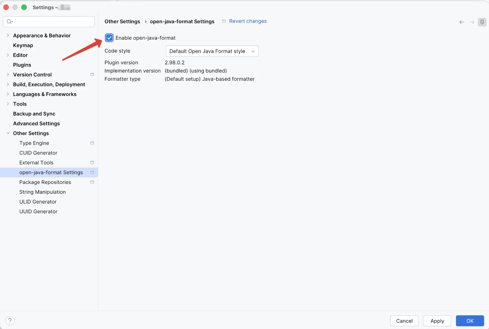
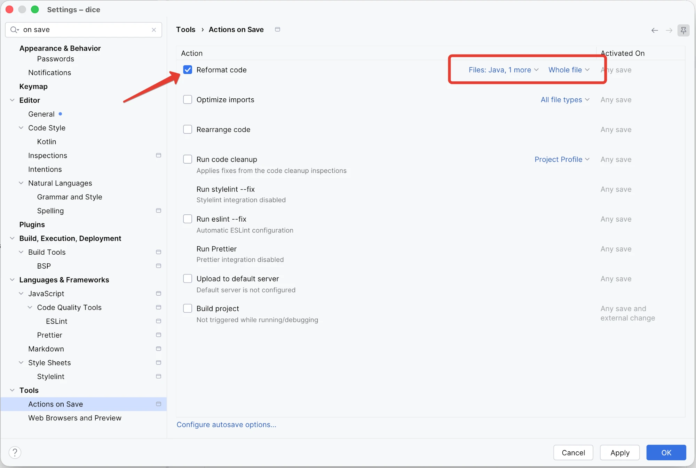

# IntelliJ IDEA

With the plugin enabled, **Reformat Code** runs open-java-format instead of the IDE's built-in Java
formatter, so the IDE and the build produce identical files. The IDE's own Java code style settings
stop applying.

The plugin needs IntelliJ IDEA 2024.2 or later, or another JetBrains IDE with Java support, such as
Android Studio.

<iframe src="https://plugins.jetbrains.com/embeddable/card/34359" width="384" height="319" title="open-java-format on the JetBrains Marketplace" loading="lazy" style="border: 0; max-width: 100%;"></iframe>

## Install

### From the JetBrains Marketplace

1. Open **Settings**, go to **Plugins** and switch to the **Marketplace** tab.
2. Search for **open-java-format** and click **Install**.
3. Restart the IDE.

The [plugin page](https://plugins.jetbrains.com/plugin/34359-open-java-format) on the Marketplace
has an **Install to IDE** button that does the same for an IDE that is already running.

### From a file

A version that is not on the Marketplace yet can be installed from a release.

1. Download `open-java-format-idea-plugin-{{ ojf_version }}.zip` from the
   [latest release](https://github.com/openjavaformat/open-java-format/releases/latest). Do not
   unpack it.
2. Open **Settings**, go to **Plugins**, click the gear icon and choose **Install Plugin from
   Disk…**.
3. Select the zip file and restart the IDE.

## Enable it for a project

The plugin is off in every project until you turn it on.

1. Open **Settings** and go to **Tools → open-java-format Settings**.
2. Tick **Enable open-java-format**.

{ width="565" height="455" loading="lazy" }

From then on Reformat Code, ++ctrl+alt+l++ or ++option+cmd+l++ on macOS, formats Java files with
open-java-format.

## Format on save

1. Open **Settings** and go to **Tools → Actions on Save**.
2. Tick **Reformat code**.
3. Next to it, choose **Java** in the file list and **Whole file** instead of **Changed lines**.

{ width="1000" height="674" loading="lazy" }

Limiting it to Java keeps other files out: the IDE would reformat those with its own formatters.
**Whole file** formats the entire file, which is what the [GitHub Action](github-actions.md) checks.
**Changed lines** formats only the lines you edited, the way `formatDiff` does.

## Which formatter version runs

A project that applies the [Gradle plugin](gradle.md) takes the formatter version from the build.
Every other project uses the version bundled with the IDE plugin.

By default the formatter runs in a process of its own, on the IDE's runtime, so the project SDK can
be any version.

## Native binary

Reformat Code starts the formatter as a new process for every file, and the Java-based formatter
starts a JVM each time, which a whole directory makes you feel. The native binary starts without
one: on an Apple silicon Mac a file takes about 40 ms instead of 430 ms.

It is a setting of the IDE and works in any project, whether Maven, Gradle or neither builds it.

1. Open **Settings** and go to **Tools → open-java-format Settings**.
2. Tick **Use native binary**, which shows while **Enable open-java-format** is ticked.
3. Click **Download** next to **No embedded version.** The IDE downloads the binary of the plugin's
   version for your platform from Maven Central, checks it against its SHA-256 checksum and keeps
   it for every project. The line then reads **Use embedded version** and the version.
4. Click **OK**. Until there is a binary to run, OK says so and keeps the page open.

**Active formatter** at the bottom of the page names what runs once you click OK, and follows the
page as you change it: the Java-based formatter, the binary's path, or the version that still
needs downloading. `idea.log` has a line starting with `open-java-format: using` each time the
plugin starts a formatter.

!!! note "Projects that set `openjavaformat.native.formatter`"

    Up to 21.0.1 that Gradle property also switched the IDE to the native binary. It now applies to
    the build alone, so tick **Use native binary** once in such a project.

### A binary of your own

To run another binary, such as one from the [command line](command-line.md) page, choose it in
**Binary** under **Use native binary**. It takes the place of the embedded one; empty the field to
go back to the embedded binary.

### After an update of the plugin

The binary of the previous version keeps formatting. When a project opens, a notification says
that a newer one is available, with **Download** and **Ignore**; Ignore holds until the plugin's
next version. **Update to latest**, next to the version on the settings page, does the same at any
time: it downloads the plugin's version, and does nothing when that is the one in use. Once the
newer binary is in, the old one is deleted.

### Platforms

The binary is published for Linux with glibc on x86-64 and AArch64, macOS on Apple silicon and
Intel, and Windows on x86-64. Anywhere else, such as Windows on ARM or Alpine, the settings page
says there is none and the Java-based formatter runs, unless you choose a binary of your own.
