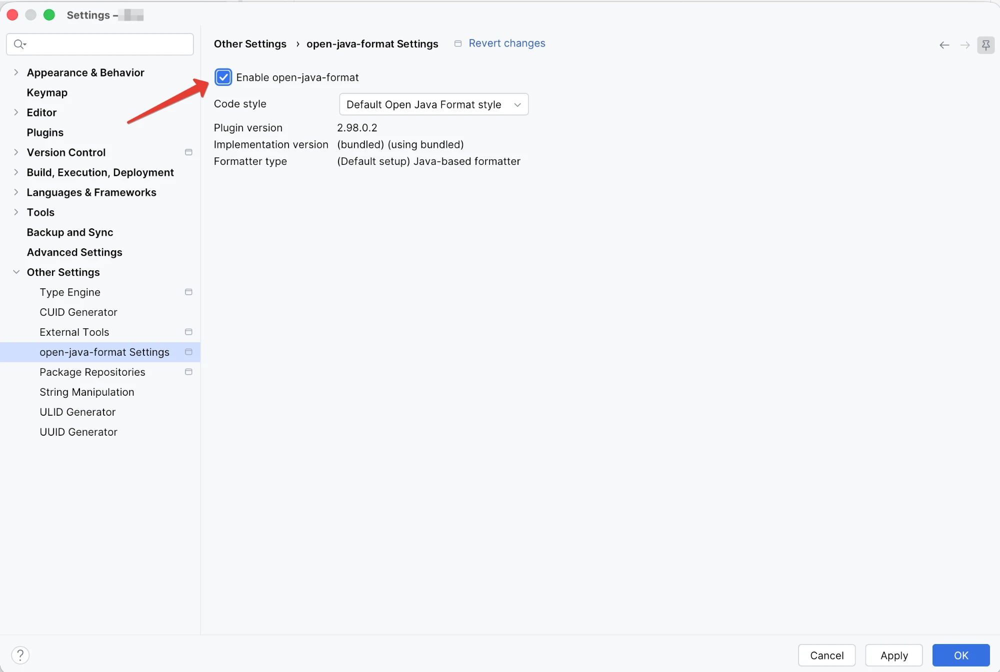
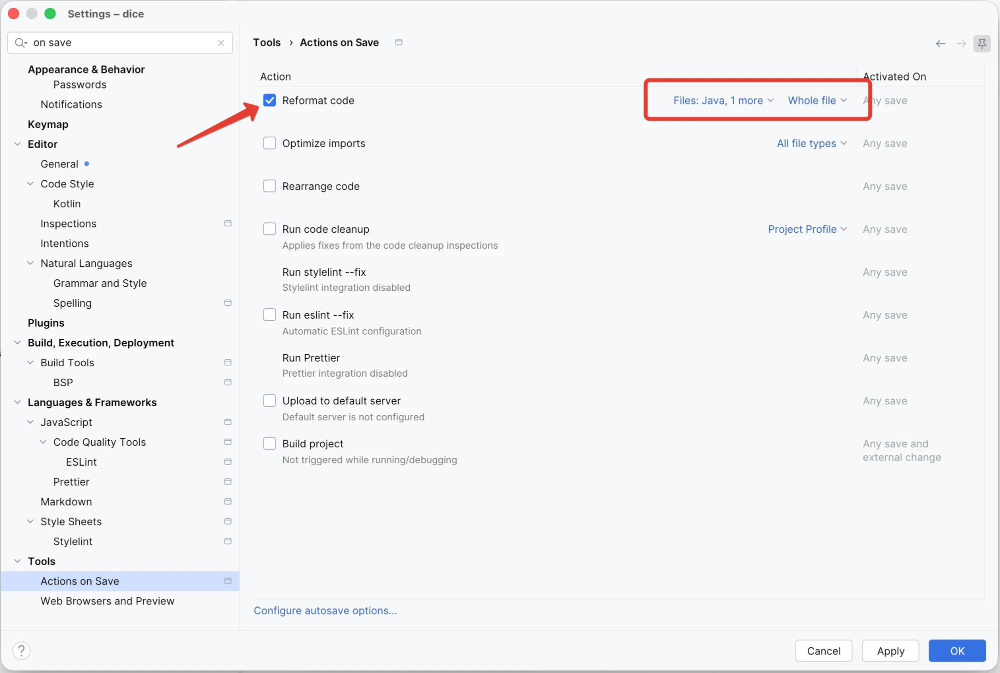

# IntelliJ IDEA

With the plugin enabled, **Reformat Code** runs open-java-format instead of the IDE's built-in Java
formatter, and **Optimize Imports** removes unused imports and sorts the others as open-java-format
does, so the IDE and the build produce identical files. The IDE's own Java code style settings stop
applying.

The plugin needs IntelliJ IDEA 2024.2 or later, or another JetBrains IDE with Java support, such as
Android Studio.

<iframe src="https://plugins.jetbrains.com/embeddable/card/34359" width="384" height="319" title="open-java-format on the JetBrains Marketplace" loading="lazy" style="border: 0; max-width: 100%;"></iframe>

## Install

### From the JetBrains Marketplace

1. Open **Settings**, go to **Plugins** and switch to the **Marketplace** tab.
2. Search for **open-java-format** and click **Install**.
3. Restart the IDE.

The [plugin page](https://plugins.jetbrains.com/plugin/34359-open-java-format) on the Marketplace
has an **Install to IDE** button that does the same for an IDE that is already running.

### From a file

A version that is not on the Marketplace yet can be installed from a release.

1. Download `open-java-format-idea-plugin-{{ ojf_version }}.zip` from the
   [latest release](https://github.com/openjavaformat/open-java-format/releases/latest). Do not
   unpack it.
2. Open **Settings**, go to **Plugins**, click the gear icon and choose **Install Plugin from
   Disk…**.
3. Select the zip file and restart the IDE.

## Enable it for a project

The plugin is off in every project until you turn it on.

1. Open **Settings** and go to **Tools → open-java-format Settings**.
2. Tick **Enable open-java-format**.

{ width="565" height="455" loading="lazy" }

From then on Reformat Code, ++ctrl+alt+l++ or ++option+cmd+l++ on macOS, formats Java files with
open-java-format, and Optimize Imports, ++ctrl+alt+o++ or ++ctrl+option+o++ on macOS, fixes their
imports.

## Format on save

1. Open **Settings** and go to **Tools → Actions on Save**.
2. Tick **Reformat code**.
3. Next to it, choose **Java** in the file list and **Whole file** instead of **Changed lines**.
4. Tick **Optimize imports**.

{ width="1000" height="674" loading="lazy" }

Limiting it to Java keeps other files out: the IDE would reformat those with its own formatters.
**Whole file** formats the entire file, which is what the [GitHub Action](github-actions.md) checks.
**Changed lines** formats only the lines you edited, the way `formatDiff` does.

## Imports

Optimize Imports removes the unused imports and sorts the others as the command line does, and
leaves the rest of the file as it is. Everything in the IDE that optimizes imports runs it: the
**Optimize imports** option of Reformat File, Actions on Save and **Optimize imports** in the
commit dialog. Reformat Code alone leaves the imports as they are.

The imports the IDE adds itself, by auto-import, ++alt+enter++ or completion, follow
open-java-format's layout while the plugin is enabled: one import for each class, never `.*`, and
the static imports first. The Java code style page says so at the top, with "Settings may be
overridden by open-java-format", and its **Disable** link switches the plugin off for the project.

{ width="1000" height="600" loading="lazy" }

!!! note "Projects with an `.editorconfig`"

    An `.editorconfig` that sets code style properties for Java files wins over the plugin: the IDE
    takes the import settings from it. Set them there with its `ij_java_*` properties, such as
    `ij_java_class_count_to_use_import_on_demand = 999`.

!!! note "Optimize imports on the fly"

    In IntelliJ IDEA 2024.2 to 2025.1, **Optimize imports on the fly** runs the plugin as you type.
    From 2025.2 the IDE does that, and **Optimize imports** under ++alt+enter++, with its own
    optimizer, which never asks a plugin: it follows the layout above, but it removes an unused
    `import a.b.*;`, which open-java-format keeps. Optimize Imports itself still runs the plugin.

## How the formatter runs

The settings page offers three ways under **Run the formatter**. Each project keeps its own choice,
in `.idea/open-java-format.xml`.

**In the IDE process**, the default, loads the formatter into the IDE's own JVM: there is nothing to
start, and a file takes milliseconds. The IDE's Java then decides which syntax parses, Java 21 in
IntelliJ IDEA 2024.2 and Java 25 in 2026.3, and the page names it under the button. Where the
formatter cannot run in the IDE, the button is greyed out with the reason under it, and the
formatter runs in a separate JVM.

**In a separate JVM** starts a JVM for every file, on the JDK chosen in **JDK**: the IDE's runtime,
which is the default, the project SDK or another JDK the IDE knows. Choose it for a project whose
syntax is newer than the IDE's Java, with a JDK that parses it. A JDK that cannot run the formatter,
older than Java 21 for one, is listed in grey.

{ width="565" height="520" loading="lazy" }

**Native binary** runs the formatter compiled for your platform, as the next section describes.

**Active formatter** at the bottom of the page names what runs once you click OK, and follows the
page as you change it: the IDE process, the java of the separate JVM, the binary's path, or the
version that still needs downloading. When what you chose cannot run, the line under it says what
runs instead and why. `idea.log` has a line starting with `open-java-format: using` each time the
plugin starts a formatter.

A project that had **Use native binary** ticked before the plugin offered these three keeps the
native binary; every other project moves to the IDE process. A plugin older than 21.1.0 that reads
the file of a newer one formats in a JVM of its own.

## Which formatter version runs

A project that applies the [Gradle plugin](gradle.md) takes the formatter version from the build.
Every other project uses the version bundled with the IDE plugin. The formatter of a build runs only
in a trusted project.

## Native binary

The native binary is the formatter compiled ahead of time: like a separate JVM it starts for every
file, but without a JVM to start, so on an Apple silicon Mac a file takes about 40 ms instead of
430 ms.

It is a setting of the IDE and works in any project, whether Maven, Gradle or neither builds it.

1. Open **Settings** and go to **Tools → open-java-format Settings**.
2. Choose **Native binary** under **Run the formatter**.
3. Click **Download** next to **No embedded version.** The IDE downloads the binary of the plugin's
   version for your platform from Maven Central, checks it against its SHA-256 checksum and keeps
   it for every project. The line then reads **Use embedded version** and the version.
4. Click **OK**. Until there is a binary to run, OK says so and keeps the page open.

!!! note "Projects that set `openjavaformat.native.formatter`"

    Up to 21.0.1 that Gradle property also switched the IDE to the native binary. It now applies to
    the build alone, so choose **Native binary** once in such a project.

### A binary of your own

To run another binary, such as one from the [command line](command-line.md) page, choose it in
**Binary** under **Native binary**. It takes the place of the embedded one; empty the field to go
back to the embedded binary.

### After an update of the plugin

The binary of the previous version keeps formatting. When a project opens, a notification says
that a newer one is available, with **Download** and **Ignore**; Ignore holds until the plugin's
next version. The settings page offers the same at any time: while the binary is of another version
than the plugin, **Update to** and the plugin's version stand next to it. Once the newer binary is
in, the old one is deleted.

### Platforms

The binary is published for Linux with glibc on x86-64 and AArch64, macOS on Apple silicon and
Intel, and Windows on x86-64. Anywhere else, such as Windows on ARM or Alpine, the settings page
says there is none and the formatter runs in a separate JVM, unless you choose a binary of your own.
